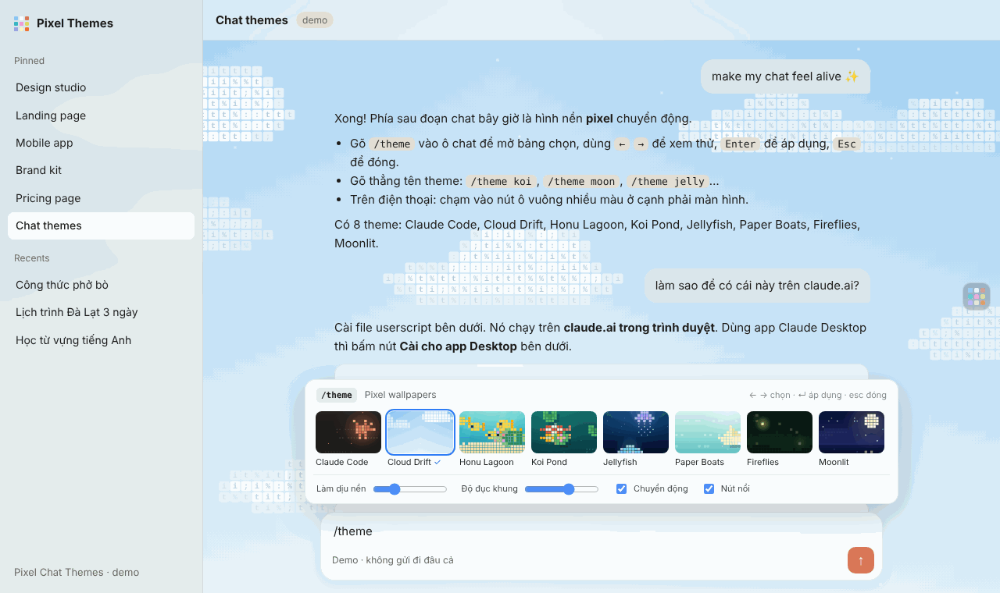

# Pixel Chat Themes

Hình nền **pixel / ASCII chuyển động** phía sau khung chat của Claude, giống các video "Claude chat theme" đang lan truyền. Có 9 cảnh: mây trôi, hồ cá koi, rùa biển, sứa phát sáng, thuyền giấy, đom đóm, trăng sao, terminal và cờ Việt Nam tung bay. Miễn phí, mã nguồn mở, không thu thập dữ liệu.



**Xem thử ngay, không cần cài:** https://aqua2409z.github.io/pixel-chat-themes/

## Cài trong 1 phút

| Bạn dùng Claude ở đâu | Cách cài | Hình nền |
|---|---|---|
| **Trình duyệt máy tính** (Chrome, Edge, Firefox, Brave) | Cài [Tampermonkey](https://www.tampermonkey.net/), rồi mở [**link cài script**](https://raw.githubusercontent.com/aqua2409z/pixel-chat-themes/main/claude-pixel-themes.user.js) và bấm *Install* | Nguyên màn hình, tự chạy |
| **iPhone / iPad** (Safari) | Cài app *Userscripts* rồi mở link cài script ở trên | Nguyên màn hình, tự chạy |
| **Android** (Firefox) | Cài *Violentmonkey* trong Firefox rồi mở link cài script | Nguyên màn hình, tự chạy |
| **App Claude Desktop, tab Code** | **+** → **Plugins** → **Add marketplace** → nhập `aqua2409z/pixel-chat-themes` → cài **pixel-themes** → gõ `/pixel` | Dải cảnh trên ô chat, khung bên cạnh, viền tin nhắn |
| **App Claude Desktop, nguyên màn hình** | Làm theo [**trợ lý cài đặt 6 bước**](https://aqua2409z.github.io/pixel-chat-themes/setup.html) (dùng Developer Mode) | Nguyên màn hình, chạy lại mỗi lần mở app |

Từng bước chi tiết cho người mới, kèm phần xử lý sự cố: [**HUONG-DAN.md**](HUONG-DAN.md)

App Claude trên điện thoại (cài từ App Store / CH Play) không cho cài thêm gì. Trên điện thoại hãy mở claude.ai bằng trình duyệt.

## Các theme

| Theme | Gõ nhanh | Cảnh |
|---|---|---|
| Claude Code | `/theme code` | Nền terminal tối, tia sáng cam nhấp nháy, dòng code trôi |
| Cloud Drift | `/theme may` | Trời xanh, mây ghép từ ký tự trôi ngang |
| Honu Lagoon | `/theme rua` | Đầm nước xanh, rùa biển, đàn cá, san hô, rong |
| Koi Pond | `/theme koi` | Hồ cá koi, lá sen, gợn sóng |
| Jellyfish | `/theme sua` | Biển sâu, sứa phát sáng bơi lên |
| Paper Boats | `/theme thuyen` | Thuyền giấy dập dềnh trên sóng |
| Fireflies | `/theme dom dom` | Rừng đêm, đom đóm lập lòe |
| Moonlit | `/theme trang` | Trăng, sao lấp lánh, sao băng, mặt biển |
| Việt Nam | `/theme co` hoặc `/theme viet nam` | Cờ đỏ sao vàng tung bay trên nền trời bình minh, núi đá vôi Hạ Long và mặt nước lấp lánh |

Trong tab Code của app Desktop thì dùng `/pixel` thay cho `/theme` (ví dụ `/pixel koi`).

## Cách dùng trên claude.ai

| Thao tác | Kết quả |
|---|---|
| Gõ `/theme` trong ô chat | Mở bảng chọn ngay trên ô chat |
| `←` `→` | Xem thử theme |
| `Enter` | Áp dụng (tin nhắn `/theme` **không** bị gửi cho Claude) |
| `Esc` | Đóng, giữ theme cũ |
| `/theme koi`, `/theme trang`, `/theme off` | Đổi thẳng theo tên hoặc tên tiếng Việt không dấu |
| `Alt + T` | Mở/đóng bảng chọn |
| Nút ô vuông nhiều màu ở cạnh phải | Mở bảng chọn (tiện trên điện thoại) |

Bộ gõ Telex hay biến `/theme` thành `/thêm`. Script hiểu cả `/thêm` và `/nen`, nên không cần tắt bộ gõ.

Trong bảng chọn còn có:

- **Làm dịu nền**: phủ thêm một lớp mờ để chữ dễ đọc hơn.
- **Độ đục khung**: độ trong của thanh bên, ô chat và bong bóng tin nhắn.
- **Chuyển động**: tắt để nền đứng yên (đỡ tốn pin).
- **Nút nổi**: ẩn/hiện nút ở cạnh phải.

Theme tối (Koi Pond, Jellyfish, Fireflies, Moonlit, Claude Code) đẹp nhất khi claude.ai ở giao diện **Dark**, theme sáng thì hợp giao diện **Light**. Nếu không khớp, script tự phủ thêm lớp mờ để chữ vẫn đọc được.

## Cách hoạt động

1. Một `<canvas>` toàn màn hình nằm **sau** trang (z-index −1) và vẽ cảnh bằng lưới ô vuông nhỏ. Mỗi ô chứa một ký tự ASCII, nên nhìn giống pixel.
2. Script đọc **màu nền thật** của từng khung (không dựa vào tên class) rồi xử lý:
   - Khung lớn (nền chính) → trong suốt.
   - Khung nhỏ hơn (thanh bên, ô chat, bong bóng tin nhắn, menu) → kính mờ.
   - Nút màu nổi bật như nút gửi → giữ nguyên.

   Nhờ vậy khi claude.ai đổi giao diện, script vẫn chạy được trong đa số trường hợp.
3. Không dùng `innerHTML` hay `<style>` inline, nên chạy được cả trên trang có Content-Security-Policy / Trusted Types chặt.
4. Chạy 10–12 khung hình/giây (đúng chất pixel), tự dừng khi chuyển tab, và đứng yên nếu máy bật chế độ giảm chuyển động.
5. Script **không gửi dữ liệu đi đâu**. Nó chỉ lưu cài đặt (`pixel-themes:v1`) trong localStorage của claude.ai.

## Tự tạo theme

Mỗi theme là một object trong mảng `THEMES` của file script:

```js
THEMES.push({
  id: 'sakura', name: 'Sakura', dark: false, alias: ['hoa'],
  glyphs: '*.:',                       // ký tự in trong các ô
  bg(ctx, w, h) { /* vẽ gradient nền một lần */ },
  init(world) {                        // tạo trạng thái ban đầu
    world.s.petals = Array.from({ length: 30 }, () => ({ x: Math.random() * world.cols, y: Math.random() * world.rows }));
  },
  frame(world, dt) {                   // gọi mỗi khung hình
    for (const p of world.s.petals) {
      p.y += dt; if (p.y > world.rows) p.y = 0;
      world.tile(p.x, p.y, '#ffc4d6', '#e88aa8', '*');   // ô: (cột, hàng, màu ô, màu chữ, ký tự)
    }
  },
});
```

Các hàm vẽ có sẵn: `world.tile`, `world.sprite` (vẽ hình từ ASCII art), `world.glyph`, `world.dot`, `world.glow`.

## Mod cho app Claude Desktop (tab Code)

Thư mục [`pixel-themes/`](pixel-themes/) là một plugin chính thức cho Claude Code. Plugin chỉ được vẽ ở dải trên ô chat, khung bên cạnh và quanh tin nhắn, nên không phủ kín phía sau khung chat như trên web. Lệnh và chi tiết: [pixel-themes/README.md](pixel-themes/README.md).

## Cấu trúc

```
claude-pixel-themes.user.js   userscript cho claude.ai, cũng là thư viện của trang demo
index.html                    trang demo kiểu ứng dụng chat
setup.html                    trợ lý cài đặt cho app Claude Desktop
HUONG-DAN.md                  hướng dẫn từng bước cho người mới
pixel-themes/                 plugin (mod) cho tab Code của app Claude Desktop
.claude-plugin/               marketplace để app Desktop cài plugin từ repo này
assets/, preview.png          ảnh
```

## Giới hạn

- App Claude trên điện thoại không cài thêm được gì. App Desktop dùng mod (tab Code) hoặc trợ lý cài đặt (nguyên màn hình).
- Nếu claude.ai thay đổi lớn về giao diện, có thể có khung chưa được làm trong suốt. Khi đó mở bảng `/theme` và chọn **Tắt**, rồi [báo lỗi](https://github.com/aqua2409z/pixel-chat-themes/issues).
- Hiệu ứng kính mờ (`backdrop-filter`) tốn GPU hơn một chút trên máy yếu. Tăng **Độ đục khung** lên tối đa để tắt hiệu ứng mờ.

## Ủng hộ tác giả

Pixel Chat Themes miễn phí và sẽ luôn miễn phí. Nếu thấy hữu ích, bạn có thể mời mình ly cà phê ☕, **tuỳ tâm, không bắt buộc**. Quét mã bằng app ngân hàng bất kỳ:


| Ngân hàng | Số tài khoản |
|---|---|
| MB Bank (Ngân hàng Quân đội) | `0923017526` |

Nội dung chuyển khoản gợi ý: `Pixel Themes`. Bấm ⭐ **Star** cho repo hoặc chia sẻ cho bạn bè cũng là một cách ủng hộ. Cảm ơn bạn!

## Góp ý, báo lỗi

Gặp lỗi hoặc muốn thêm theme mới? Mở [Issue](https://github.com/aqua2409z/pixel-chat-themes/issues), nhớ kèm ảnh chụp màn hình và cho biết bạn dùng trình duyệt hay app nào. Pull request luôn được chào đón.

## Giấy phép

[MIT](LICENSE): ai cũng được dùng, sửa và chia sẻ lại miễn phí, chỉ cần giữ dòng ghi tên tác giả.

---

<details>
<summary><b>English</b></summary>

**Pixel Chat Themes** adds animated pixel/ASCII wallpapers behind the Claude chat: 9 scenes (clouds, koi pond, sea turtles, jellyfish, paper boats, fireflies, moonlit sea, terminal spark, and Vietnam's flag waving over Ha Long Bay).

- **claude.ai in a browser** (desktop, iPhone Safari, Android Firefox): install a userscript manager (Tampermonkey, Userscripts, Violentmonkey), then open the [install link](https://raw.githubusercontent.com/aqua2409z/pixel-chat-themes/main/claude-pixel-themes.user.js). Type `/theme` or press `Alt+T`.
- **Claude Desktop, Code tab**: **+** → **Plugins** → **Add marketplace** `aqua2409z/pixel-chat-themes` → install **pixel-themes**, then run `/pixel`. Plugins can only draw a strip above the prompt, a side pane and message frames.
- **Claude Desktop, full window**: enable *Help → Troubleshooting → Enable Developer Mode*, open DevTools (`Ctrl+Alt+I` on Windows, `Cmd+Option+I` on Mac), paste the script into the Console. It lasts until the app restarts. See the [setup helper](https://aqua2409z.github.io/pixel-chat-themes/setup.html).

MIT licensed. Donations are optional: MB Bank `0923017526` (VietQR above).

</details>
