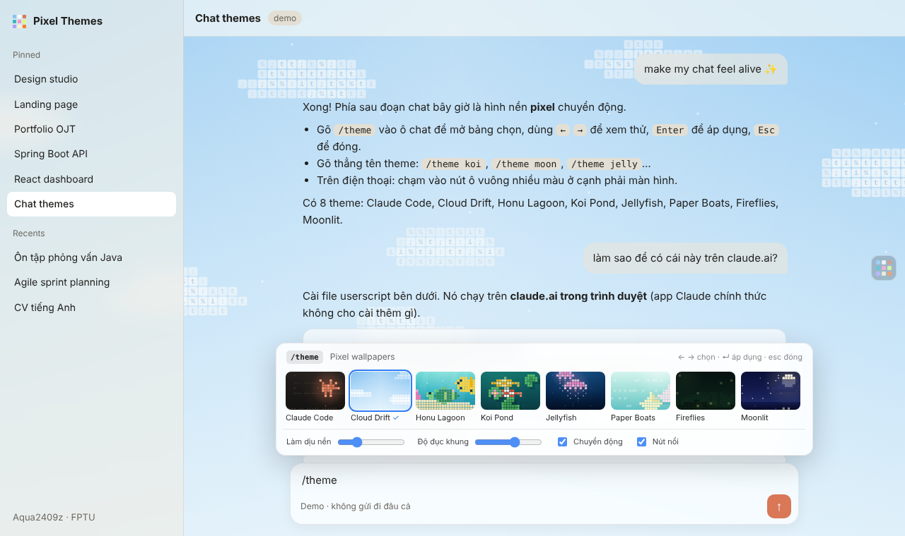

# Pixel Chat Themes cho Claude

Hình nền **pixel / ASCII chuyển động** phía sau khung chat của Claude, giống các video "Claude chat theme" đang lan truyền. Có 8 cảnh: mây trôi, hồ cá koi, rùa biển, sứa phát sáng, thuyền giấy, đom đóm, trăng sao và terminal. Miễn phí, mã nguồn mở, không thu thập dữ liệu.

**Xem thử ngay, không cần cài:** https://aqua2409z.github.io/About-Me-/chat-themes/

## Cài trong 1 phút

| Bạn dùng Claude ở đâu | Cách cài | Hình nền |
|---|---|---|
| **Trình duyệt máy tính** (Chrome, Edge, Firefox, Brave) | Cài [Tampermonkey](https://www.tampermonkey.net/), rồi mở [**link cài script**](https://raw.githubusercontent.com/Aqua2409z/About-Me-/main/chat-themes/claude-pixel-themes.user.js) và bấm *Install* | Nguyên màn hình, tự chạy |
| **iPhone / iPad** (Safari) | Cài app *Userscripts* rồi mở link cài script ở trên | Nguyên màn hình, tự chạy |
| **Android** (Firefox) | Cài *Violentmonkey* trong Firefox rồi mở link cài script | Nguyên màn hình, tự chạy |
| **App Claude Desktop, tab Code** | **+** → **Plugins** → **Add marketplace** → nhập `Aqua2409z/About-Me-` → cài **pixel-themes** → gõ `/pixel` | Dải cảnh trên ô chat, khung bên cạnh, viền tin nhắn |
| **App Claude Desktop, nguyên màn hình** | Làm theo [**trợ lý cài đặt 6 bước**](https://aqua2409z.github.io/About-Me-/chat-themes/setup.html) (dùng Developer Mode) | Nguyên màn hình, chạy lại mỗi lần mở app |

Từng bước chi tiết cho người mới, kèm phần xử lý sự cố: [**chat-themes/HUONG-DAN.md**](chat-themes/HUONG-DAN.md)

App Claude trên điện thoại (cài từ App Store / CH Play) không cho cài thêm gì. Trên điện thoại hãy mở claude.ai bằng trình duyệt.

## Dùng thế nào

- Trên claude.ai: gõ `/theme` trong ô chat, hoặc bấm `Alt + T`, hoặc bấm nút ô vuông nhiều màu ở cạnh phải.
- Trong tab Code của app Desktop: gõ `/pixel`.
- Đổi thẳng theo tên: `/theme koi`, `/theme trang` (trăng), `/pixel sua` (sứa)… Gõ `off` để tắt.

Chi tiết tính năng, cách hoạt động và cách tự tạo theme: [chat-themes/README.md](chat-themes/README.md)

## Ủng hộ tác giả

Pixel Chat Themes miễn phí và sẽ luôn miễn phí. Nếu thấy hữu ích, bạn có thể mời mình ly cà phê ☕, **tuỳ tâm, không bắt buộc**:

| Ngân hàng | Số tài khoản |
|---|---|
| MB Bank (Ngân hàng Quân đội) | `0923017526` |

Nội dung chuyển khoản gợi ý: `Pixel Themes`. Bấm ⭐ **Star** cho repo hoặc chia sẻ cho bạn bè cũng là một cách ủng hộ. Cảm ơn bạn!

## Góp ý, báo lỗi

Gặp lỗi hoặc muốn thêm theme mới? Mở [Issue](https://github.com/Aqua2409z/About-Me-/issues), nhớ kèm ảnh chụp màn hình và cho biết bạn dùng trình duyệt hay app nào. Pull request luôn được chào đón.

## Về tác giả

Sinh viên năm 3 chuyên ngành Kỹ thuật Phần mềm tại Đại học FPT. Đam mê xây dựng các sản phẩm Web hiện đại, hiệu năng cao và có trải nghiệm người dùng mượt mà. Đang tích cực chuẩn bị cho kỳ thực tập doanh nghiệp (OJT) với nền tảng kiến thức vững chắc về React, Spring Boot, và quy trình phát triển phần mềm chuẩn Agile.

## Giấy phép

[MIT](LICENSE): ai cũng được dùng, sửa và chia sẻ lại miễn phí, chỉ cần giữ dòng ghi tên tác giả.

---

<b>English</b>

**Pixel Chat Themes** adds animated pixel/ASCII wallpapers behind the Claude chat: 8 scenes (clouds, koi pond, sea turtles, jellyfish, paper boats, fireflies, moonlit sea, terminal spark).

- **claude.ai in a browser** (desktop, iPhone Safari, Android Firefox): install a userscript manager (Tampermonkey, Userscripts, Violentmonkey), then open the [install link](https://raw.githubusercontent.com/Aqua2409z/About-Me-/main/chat-themes/claude-pixel-themes.user.js). Type `/theme` or press `Alt+T`.
- **Claude Desktop, Code tab**: **+** → **Plugins** → **Add marketplace** `Aqua2409z/About-Me-` → install **pixel-themes**, then run `/pixel`. Plugins can only draw a strip above the prompt, a side pane and message frames.
- **Claude Desktop, full window**: enable *Help → Troubleshooting → Enable Developer Mode*, open DevTools (`Ctrl+Alt+I` on Windows, `Cmd+Option+I` on Mac), paste the script into the Console. It lasts until the app restarts. See the [setup helper](https://aqua2409z.github.io/About-Me-/chat-themes/setup.html).

MIT licensed. Donations are optional: MB Bank `0923017526`.

